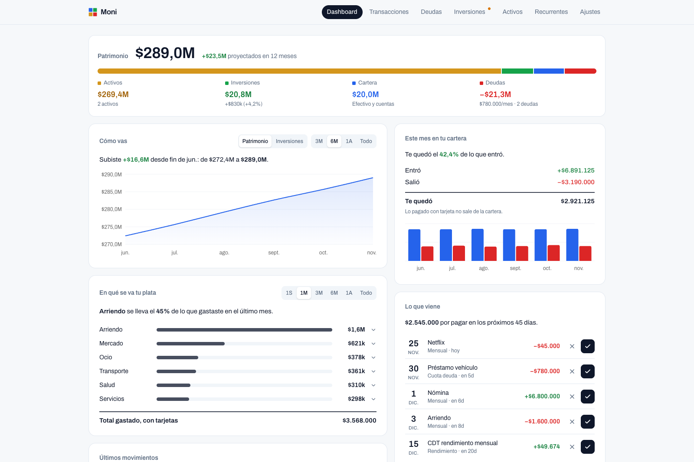
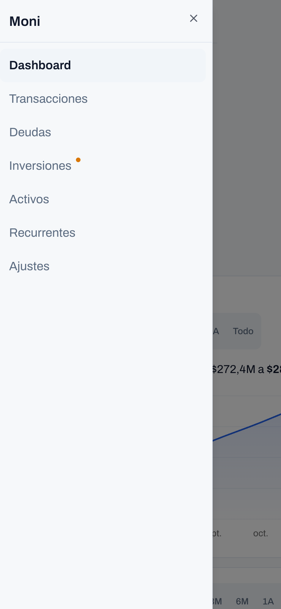
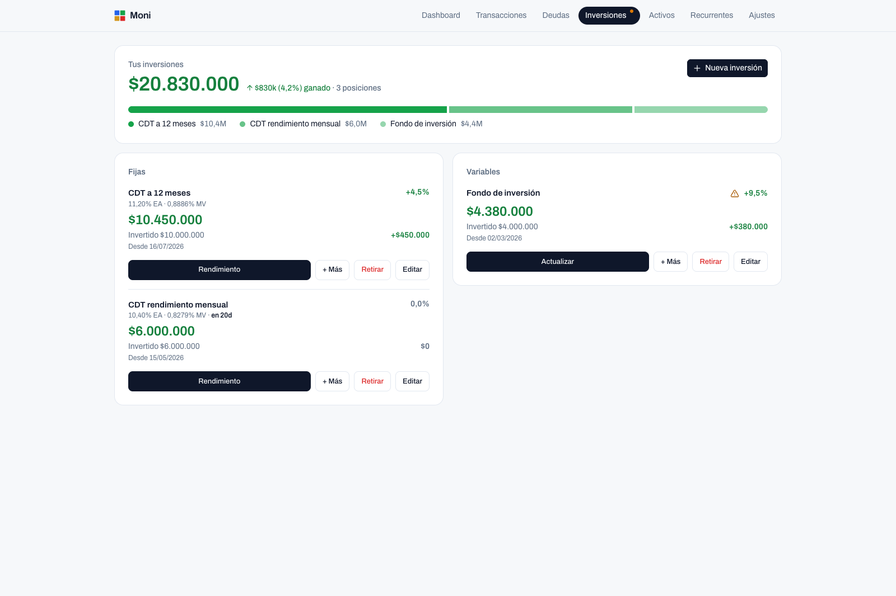
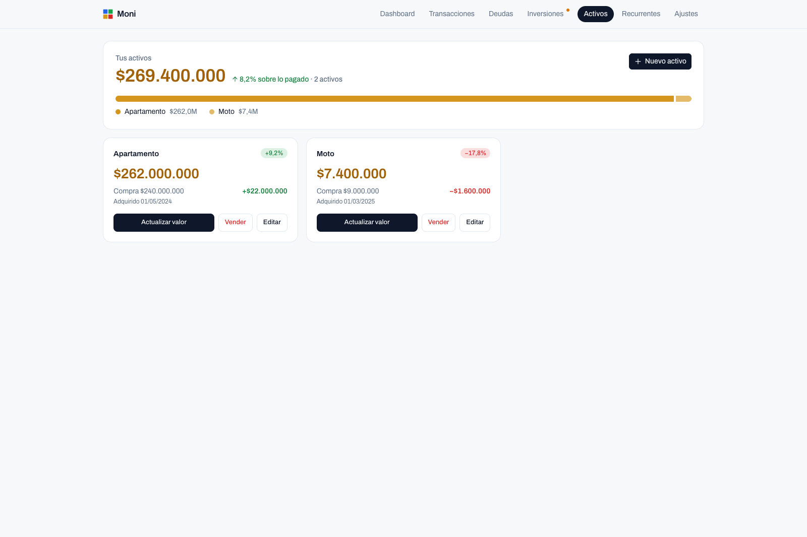

<div align="center">


# Moni

**Personal finance tracker for one household, in Colombian pesos**

 React &nbsp;·&nbsp;  TypeScript &nbsp;·&nbsp;  Tailwind CSS &nbsp;·&nbsp;  FastAPI &nbsp;·&nbsp;  SQLite &nbsp;·&nbsp;  Docker

[Features](#features) · [Docs](docs/ARCHITECTURE.md) · [License](LICENSE)

</div>

**The problem:** spending lives in one spreadsheet, the credit cards in another, the CDTs and the loan schedule in a third, and none of them agree on how much you are worth or how much cash is actually free this month.

**What Moni does:** keeps spending, cards, loans, investments, assets and recurring items in a single ledger, so net worth and available cash are computed from the same rows. A loan payment, an investment contribution or an asset sale can drop a linked entry into the ledger, and the dashboard projects the installments, yields and charges coming up. The interface is in Spanish.

<!-- demo-video:start -->
<!-- Pending: run /brag-slim, drag brag-output/brag.mp4 (<10 MB) into a GitHub issue comment,
     paste the user-attachments URL on its own line here, then remove this comment. -->
<!-- demo-video:end -->



> [!WARNING]
> Moni stores your whole financial life in one SQLite file and has a single owner login. Without `MONI_PASSWORD_HASH` nobody can sign in, and the port should not be exposed to the internet without HTTPS. Details in [Security](#security).

[Features](#features) · [How do I…](#how-do-i) · [Running](#running) · [Configuration](#configuration) · [Documentation](#documentation) · [Security](#security)

## Features

**Dashboard**

- Net worth with its composition (assets, investments, cash, debts) and how it moved over time
- Spending by category for a chosen period, and this month's cash as in minus out
- Upcoming debt installments, investment yields and recurring charges to confirm or skip

<table><tr>
<td width="74%"></td>
<td> </td>
</tr></table>

**Transacciones**

- Income, expenses and transfers filtered by month, type and category
- Grouped by date, with the payment method (cash or a specific card)
- A card expense raises that card's balance automatically


**Deudas**

- Loans and credit cards side by side, with balance, installment and interest paid
- Pay the monthly cuota, make an extra abono, take a card advance or pay it off
- Settled debts move to a "terminados" section


**Inversiones**

- Fixed-rate (CDT style, EA and MV conversion) and variable investments
- Contributions, withdrawals and manual revaluations
- A yield either capitalizes or is paid out, never both



**Activos**

- Real estate, vehicles and other assets with cost versus current value
- Value updates and sales, with an optional ledger entry



**Recurrentes**

- Recurring income and fixed expenses with monthly totals
- Pause and resume without deleting


Screenshots use fictional data.

## How do I…

### Register the monthly payment of a loan
Deudas, then the payment action on the loan, with mode `cuota`. The balance drops, interest paid accumulates and the due date moves forward one month. The form can also log the payment in the ledger. Mode `abono` pays down the balance without moving the date; `liquidar` pays it off.

### Confirm or skip an upcoming operation
On the dashboard, "próximas operaciones": the check opens the matching form already filled in and hides the operation once you save; the X hides it without registering anything. Hidden ones are listed in Ajustes.

### Record a yield on an investment
Inversiones, the yield action. Choose whether it capitalizes (raises the investment's value, no ledger entry) or is paid out (an `Intereses` income in the ledger).

### Get notified before something is due
Ajustes, Notificaciones, activate. At 8:00 (Bogota) Moni sends what is due today and tomorrow. Needs HTTPS and, on iOS, the PWA installed to the home screen.

### Back up or move your data
Ajustes, Backup, "Exportar JSON". Import adds the file's rows to the existing data and asks for your password. For the whole database use the volume backup in [docs/DEPLOYMENT.md](docs/DEPLOYMENT.md).

## Running

| I want to… | Run |
|---|---|
| Try it | `docker compose up --build`, then open `http://localhost:8080` |
| Work on the backend | `uvicorn backend.main:app --reload --port 8080` (Python 3.12, venv with `backend/requirements.txt`) |
| Work on the frontend | `cd web && npm ci && npm run dev` (Node 22, backend on 8080) |
| See it with fictional data | `python -m backend.scripts.seed_demo --db /tmp/moni_demo.db --password demo-password-123` |
| Deploy | Image on GHCR plus a compose file, see [docs/DEPLOYMENT.md](docs/DEPLOYMENT.md) |

To sign in you need a password hash: `python -m backend.seguridad hash`, then set it as `MONI_PASSWORD_HASH`.

## Configuration

Copy `.env.example` to `.env`. Only `MONI_PASSWORD_HASH` is required; the rest matter behind a reverse proxy or with passkeys and push.

```bash
MONI_PASSWORD_HASH=                       # owner password hash (python -m backend.seguridad hash), single-quoted because it contains "$"; empty means every /api route answers 401
MONI_RP_ID=moni.nufi.com.co               # WebAuthn relying party id for passkeys; use your domain, or localhost for local
MONI_ORIGIN=https://moni.nufi.com.co      # WebAuthn origin; http://localhost:8080 for local
MONI_TRUSTED_PROXIES=127.0.0.0/8,::1/128  # CIDRs allowed to set X-Forwarded-For/Proto; set the exact reverse proxy address, never a whole private range
MONI_BLOCK_HOURS=24                       # how long an IP stays blocked after 3 failed logins in an hour
MONI_PUSH_TOKEN=                          # optional bearer token (32+ chars) for POST /api/push/enviar without a session
VAPID_SUBJECT=https://moni.nufi.com.co    # contact (https: or mailto:) sent in the Web Push VAPID claim; set your own domain
```

## Documentation

| Doc | Read it when |
|---|---|
| [Architecture](docs/ARCHITECTURE.md) | You want to know how it works and why it's built this way |
| [Deployment](docs/DEPLOYMENT.md) | You're running it on a server, upgrading or backing it up |
| [Development](docs/DEVELOPMENT.md) | You're changing code: setup, tests, conventions |

## Security

Built for one owner on a home server or a private domain, not for multiple users.

- **One password, no registration.** Without `MONI_PASSWORD_HASH` the API fails closed (401). Passkeys are an optional second way in, registered from Ajustes after signing in.
- **Sessions expire.** 30 days, or 7 days without use.
- **Failed logins block the IP.** Three failures in an hour block it for `MONI_BLOCK_HOURS`. Manage with `python -m backend.seguridad blocked` and `unblock <ip>`.
- **Destructive actions ask for the password again.** Importing, wiping the data and registering a passkey require it.
- **Only `web/dist` is public.** Backend code, the SQLite file and the frontend sources are not reachable over HTTP.
- **Port 8080 listens on all interfaces by default.** If a reverse proxy is the only entry point, publish `127.0.0.1:8080:80` and set `MONI_TRUSTED_PROXIES` to its address; otherwise every client shares the proxy's IP and three failures block everyone.

---

AGPL-3.0 · [LICENSE](LICENSE)
